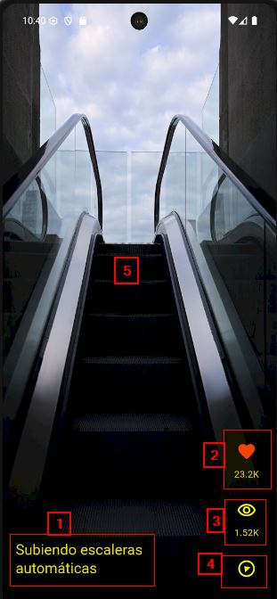
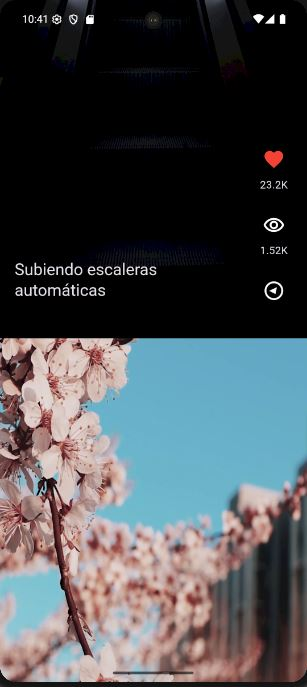
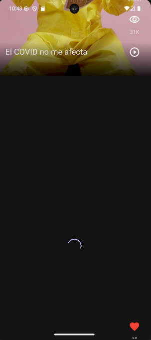

# toktik

Es un proyecto que te permite visualizar videos, y deslizar para cambiarlos.

## Caracteristicas
En este proyecto tienes distintas caracteristicas que se visualizan mientras se reproduce el video.

 

1.  El titulo del video
2.  Cantidad de me gustan
3.  Cantidad de visualizaciones
4.  Gira mientras el video se visualiza
5.  El video como tal

### Transición del video
Adicional se tiene la transicion entre videos, por lo que se muestra el proximo video mientras se sale del video actual.

Carga del video se muestra un circular load mientras se espera que el video aparesca

##Tecnologia
Esta desarrollado con flutter, la aplicacion contiene videos pregrabados simulando un receptor de videos.

Utiliza un VideoPlayerController para la reproduccion de videos, asi como GestureDetector para pausar o continuar la reproduccion